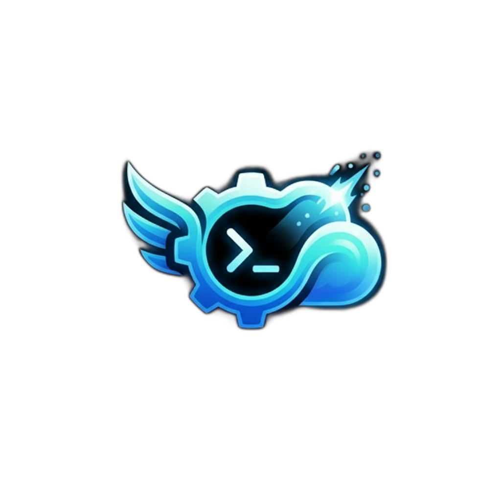

<p align="center"></p>

# Fugaro

**Lambdas for coding agents**

Ephemeral cloud jobs that turn tasks into pull requests.

<a href="https://cla-assistant.io/dimipaun/fugaro"></a>

Website: [fugaro.dev](https://fugaro.dev)

*Fugax* is Latin for "fleeting." Fugaro runs long, self-contained coding-agent loops (implement, test, review, fix, compile, open a pull request) in throwaway cloud containers instead of on your laptop. Each task gets its own Cloud Run job execution in your own Google Cloud project, runs Claude Code headless to completion, pushes its work, opens a pull request and disappears. Google Cloud is the only backend.

> **Status: pre-1.0.** Minor versions may break things. Releases and their notes are on the [Releases page](https://github.com/dimipaun/fugaro/releases); how a release is cut and verified is in [docs/release.md](docs/release.md).

## Why Fugaro

Four reasons, in the order most people decide on them.

**1. Safe by construction.** The agent does not run on your machine. It runs in a throwaway container in your own cloud project, so it cannot read your laptop: not your files, your shell history, your SSH keys or your other credentials. There is no Fugaro service in between: it uses your Google Cloud project and your model credentials (a Claude subscription token, an Anthropic API key or Vertex AI), and Cloud Run bills a task only while it runs. Every run that pushed ends in a pull request, a draft one if it failed, with the diff, the report and the logs; Fugaro never merges, so protect the base branch. The container can still reach the internet without restriction, its repository's secrets and git token, and (on GitHub) every repository its GitHub App is installed on: see [Safety and cost controls](#safety-and-cost-controls) for what it can and cannot reach.

**2. Scale out, and walk away.** Each task is its own job execution (up to `max_parallel`, 20 by default, and bounded by your Cloud Run quotas and your budget caps), so several agents with sub-agents, compiles and test suites no longer fight over one laptop's CPU, memory and battery. Start a batch (`fugaro run --attempts N` for best-of-N on one task, or many tasks at once), close the laptop and come back to pull requests with their reports, logs and cost.

**3. Team control in one place.** Policy lives in the project, not on each laptop. A project layer publishes shared defaults and named workflow profiles that every repository inherits, with rules for what a repository may change; the review loop is chosen from a catalog of recipes; only trusted authors can start a review or a follow-up; the owner decides which repositories' code may be sent to which model provider; spend is capped per stage by default, per run and per project when you turn the budget on, with kill switches; each workflow's job reads only the secrets that workflow mounts. These are enforcement points, not guarantees: the people who operate an installation are trusted, and the [security model](docs/design/v1.md#6-security-model) lists the residual risks.

**4. The newest tools and models, ready to use.** One pinned, multi-architecture base image (Debian, with `mise` for each project's runtimes from its `mise.toml`) carries Claude Code, the tooling agents reach for, and [graphify](docs/base-image.md), so a run starts the same way for everyone and the image is rebuilt when a daily check finds it stale. Codex, Gemini CLI, Pi, Qwen Code, OpenCode, Goose and Crush are installed in it too, ready to be wired in; **today only Claude Code is driven by Fugaro**. You choose the model per role: the coder can be a non-Anthropic model through OpenRouter (a DeepSeek coder and reviewer has run end to end, and it is still marked experimental) while Claude Code stays the harness, and recipes combine a cheap coder with a strong reviewer. See [docs/multi-model.md](docs/multi-model.md) and [docs/recipes.md](docs/recipes.md).

## Getting started

You need Claude Code, a billing account (setup creates a fresh Google Cloud project for Fugaro; it never uses one that already exists), `gcloud` signed in with Application Default Credentials, Terraform 1.9 or newer, and a GitHub or Bitbucket Cloud repository; for GitHub, create the GitHub App first ([docs/git-providers.md](docs/git-providers.md#github); the full list is in [Requirements](#requirements)). Install the CLI:

```sh
brew install dimipaun/tap/fugaro                      # Homebrew cask (tested on macOS)
```

Or download an archive from [Releases](https://github.com/dimipaun/fugaro/releases) (darwin and linux, amd64 and arm64) and [verify it with cosign](docs/release.md#verifying-a-release). `go install github.com/dimipaun/fugaro/cmd/fugaro@latest` is for development only: it builds a `dev` version with no release images or plugin pin.

Fugaro also has a desktop console — a graphical `fugaro watch`, with live run monitoring and spending graphs, read-only and with no telemetry of its own — and **it is not released yet**: the CLI above is the whole of what you can install today. When it ships it is published as its own release, built for macOS, and [the console page](https://fugaro.dev/console/) carries the download.

Then, in the repository's checkout:

1. Run `fugaro setup` in your own terminal. It sets up the cloud side behind confirmations you type, asks for secrets at hidden prompts, and wires the Fugaro plugin into `.claude/settings.json`.
2. Open Claude Code and run `/fugaro:setup`. It writes `fugaro.yaml` with you and opens a pull request; merge it, then run `fugaro setup` again to add the repository's job and first image build.

Commit the `.claude/settings.json` change: a teammate who opens the folder in a new Claude Code session and trusts it should get the plugin installed; if the `/fugaro:` skills are not listed (for example the folder was already trusted), run `fugaro upgrade --local` in the checkout (it installs the plugin through the `claude` CLI), then restart the session (a repository's settings can install plugins, so only trust folders you trust), and one whom an owner made a launcher, a person allowed to start runs (`fugaro setup --launcher` once per launcher; the flag replaces the list, so name the current ones too), needs only the CLI and `gcloud auth application-default login`, no `fugaro setup`. Then hand it work:

```sh
fugaro run "add a --verbose flag to the export command"
fugaro runs ls --watch          # your runs until they settle
fugaro diagnose <run>      # what happened: tests, review findings, cost, PR
fugaro run --pr 42         # continue PR 42 from its trusted review comments
```

Or ask your agent: the plugin's `working` skill launches, watches and diagnoses runs, `routing` decides what belongs in the cloud and `parallelism` how wide to fan out. Every flag: the generated [CLI reference](website/content/cli-reference.md).

## Upgrading

`brew upgrade dimipaun/tap/fugaro && fugaro upgrade`, in each checkout, in your own terminal. `fugaro upgrade` pins the plugin in `.claude/settings.json` to the new release (commit the diff), installs or updates it in Claude Code through the `claude` CLI (restart running sessions), and moves the repository's job images onto the release's base image. It asks at each cloud step; `--yes` confirms them all, each billable build included. `--local` does the first two only, `--check` only reports (exit 1 when something is stale); in Claude Code `/fugaro:upgrade` does the local half and hands you the rest ([design/upgrade.md](docs/design/upgrade.md)). If the project config (providers, model_prices, budget settings, the compute price override, the GitHub App ID) changed since the job was last deployed by `fugaro update --repo`, it also tells you to run `fugaro update --repo .` ([multi-model.md](docs/multi-model.md)); it never runs that itself.

## How it works

Every run that pushed ends in a pull request, a draft one if it failed. The draft appears at the run's first checkpoint push (within about a minute of its first commit), marked not verified.

```
your machine                        your Google Cloud project
------------                        -------------------------
Claude Code + fugaro plugin         Cloud Run job per repository workflow,
fugaro CLI ---- run ------------->    one execution per task, then gone
           <--- ls, logs, diagnose  Cloud Storage: tasks, run records, caches
                                    Secret Manager: each repository's secrets
                                    Cloud Build: each repository's image
                                    Firebase (optional): the shared budget
```

1. **Start** from the image of the repository's workflow (a named build-and-test setup in its `fugaro.yaml`): the one Fugaro base plus its checkout, its runtimes (from `mise.toml`) and its dependencies, rebuilt by Cloud Build when a daily check finds it stale.
2. **Sync** to the exact target commit and restore the dependency caches.
3. **Loop:** Claude Code implements, writes tests, runs the build and tests through a recording wrapper, reviews and fixes, for as many review rounds as configured.
4. **Push and open the pull request**: each commit is pushed within about a minute while the agent works, a draft opens at the first push (marked not verified), and it is marked ready only when the run passes. Reviewers are requested only then. Set `git.pr.checkpoints` only once everyone is on 0.5.1, and refresh older job images with `fugaro image refresh`; on a host without draft PRs set `git.pr.early_draft: false` ([details](docs/git-providers.md#checkpoint-pushes-gitprcheckpoints)).
5. **Write caches back and exit.** The run record and the PR remain; the container does not.

The engine is generic: everything specific to a repository lives in its `fugaro.yaml`. The design is [docs/design/v1.md](docs/design/v1.md).

## Safety and cost controls

The model budget (below) can cap what one run spends on the model. A run halts when its next call's worst case would pass the cap.

**What a run's agent cannot reach**
- **Your machine.** Your laptop runs the `fugaro` CLI, Terraform and `gcloud` (during `fugaro setup`) and your own agent; the run's agent is in a Cloud Run container.
- **Other repositories' cloud resources.** Each workflow's job runs as its own service account, which can read only the secrets that workflow mounts and only its own repository's run, cache and lock objects. Each repository builds with its own account into its own registry. **On GitHub the job holds the App's private key**, so a compromised run can mint tokens for every repository the App is installed on: install the App only on repositories Fugaro serves, or use one App per repository for isolation.
- **Your GitHub Actions workflow files.** On GitHub the App has exactly four repository permissions, Contents Read & write, Pull requests Read & write, Issues Read and Metadata Read, never Workflows, so GitHub refuses a push that changes `.github/workflows/`; each run's token is for one repository only. Code it pushes still runs in the workflows you already have (a `push` trigger runs your scripts with the secrets they expose). Fugaro has no equivalent guard for Bitbucket pipelines. Name the App `<yourname>-fugaro`, install it on the repository, and accept any later permission change on the installation ([docs/git-providers.md](docs/git-providers.md)).

**What it can reach, by design**
- The repository, and the secrets its workflow mounts: the git credential (on GitHub the App's private key, see above), the model credential and the workflow's declared secrets. The agent runs with permission prompts bypassed; the container is the boundary.
- **The network, without restriction.** Egress is not limited, so it reaches the model provider and the git host, but also package registries and any other host. A prompt injection in repository content or a dependency could send code or those tokens out.
- The other runs of the same repository, which share its service account.
- Whatever you run from its work. Its branches can carry scripts, hooks or a `.claude/` config: review a Fugaro pull request before you check it out and run it or open it in Claude Code. Its logs and PR text reach your own agent when it watches runs; the plugin treats that text as data, not instructions.
- The repository's branches and pull requests, with its git token. Fugaro itself never merges, but **protect the base branch** (required reviews): that is what stops a push or a merge into it.

**The controls**
- **One container per task:** a job execution with no retries and a task timeout, plus stage and total timeouts.
- **Secrets never pass through an argument or the plugin.** `fugaro secrets set` reads a value from stdin or a hidden prompt, and `fugaro setup` asks only at hidden prompts in a real terminal; the plugin's skills tell the agent never to ask for, read or print one (a lint checks the skills). Secrets are never baked into images or kept in Terraform state, and run logs and transcripts are redacted, best effort.
- **Typed confirmations for money and permanent steps.** `fugaro setup` shows each plan before applying it; creating a project, linking billing, a secret and the first billable build are typed at a real terminal and never covered by `--yes`. It applies nothing when a coding agent's environment variable is set: a mitigation, not a barrier.
- **Spend caps, on by default:** every stage passes Claude Code a dollar limit (`agent.max_budget_usd`, default 25).
- **Spend caps, opt-in:** with the budget on and `agent.auth: api-key` (an Anthropic API key), a gateway (a local proxy in the runner that every model call goes through) prices each call and, in `enforce` mode, halts the run at its dollar cap; `oauth` runs can get a token cap. The budget is off by default, and a Firebase budget starts in `observe`, which counts and logs would-be cap refusals but refuses no call until you switch to `enforce` (kill switches still work). With a Firebase project (`fugaro update --firebase-project`), runs also share daily caps per repository and project, and kill switches (`fugaro budget kill`, or `k`/`K` in `fugaro watch`) halt running runs within seconds. The caps guard against mistakes and expensive tasks, not against a hostile agent. An optional GCP billing budget alert (`--budget`) is the backstop.
- **Log isolation.** Run logs carry agent output, so by default they go to Fugaro's own log bucket, which only launchers and operators (and the project's owners and editors) can read.
- **Pinned releases.** Release checksums are signed with cosign; `fugaro setup` resolves the base image's release tag on ghcr.io, verifies the cosign signature the release attached to that exact digest, and pins the digest through the installation's own Artifact Registry remote repository — nothing is copied and nothing is pushed; `--expect-digest` cross-checks the verified digest. It pins the plugin to the binary's release.

The full model, with its residual risks: [design §6](docs/design/v1.md#6-security-model). Budget setup: `fugaro update --firebase-project <gcp-project-id> --budget-mode observe` turns it on counting-only, `fugaro budget set` writes the caps, `--budget-mode enforce` is what refuses a call, and `off` turns it back off ([design/m9-budget-and-dashboard.md](docs/design/m9-budget-and-dashboard.md)).

## Per-repository configuration

Each repository carries a `fugaro.yaml`. `/fugaro:setup` writes it with you; `fugaro config example` prints the annotated template and `fugaro validate` checks it. A trimmed example:

```yaml
version: 1
project: aurora               # the Fugaro project this repository belongs to
gcp_project: my-gcp-project   # written by fugaro update --anchor, run in the checkout
git:
  provider: github            # github | bitbucket
  base_branch: main
agent:
  auth: oauth                 # oauth | api-key | vertex | cascade
  review_rounds: 2            # review and fix rounds before the PR is marked ready
  max_budget_usd: 25          # per stage
workflows:
  web:
    # the repository's mise.toml (or image.tools) declares its runtimes
    commands:
      build: npm run build
      test: npm test
    secrets:                  # logical names; values stored with fugaro secrets set
      - { name: npm-token, env: NPM_TOKEN }
    resources: { cpu: 4, memory: 8Gi }
    timeouts: { total: 90m, stage: 40m, verify: 30m, finalize_reserve: 5m }
```

`agent.models` pins a model per role (coder, reviewer, background), and an optional `budget:` block can only tighten the owner's caps ([design/m9-budget-and-dashboard.md](docs/design/m9-budget-and-dashboard.md)). **Other models (experimental):** the coder can be a non-Anthropic model through OpenRouter, while Claude Code stays the harness and, by default, Claude the reviewer; the project owner opts each repository in. Setup: [Other models through OpenRouter](#other-models-through-openrouter); the full guide is [docs/multi-model.md](docs/multi-model.md).

**Recipes:** pick the review loop per run (`fugaro run --recipe solo`) or per repository (`agent.recipe`); see [docs/recipes.md](docs/recipes.md).

**Project layer:** a project can publish shared defaults and named workflow profiles that every anchored repository's minimal `fugaro.yaml` inherits; see [docs/project-layer.md](docs/project-layer.md).

**Checkout:** by default a workflow runs a per-repository image with a clone baked into it (`checkout: baked`); a workflow can instead run the installation's base image and clone blobless at start (`checkout: clone`), for repositories that need no build; see [docs/checkout.md](docs/checkout.md).

## Other models through OpenRouter

A run's coder can be a non-Anthropic model served by OpenRouter — one key for models Claude Code cannot reach, with the gateway pricing every call — while Claude Code stays the harness. **Claude models go direct to Anthropic by default** (`claude-*` and `anthropic/*`, with your Anthropic key); sending one through a provider is an explicit opt-in the **owner** grants by listing that one model, spelled exactly `anthropic/<id>`, in a provider's `models` — never a wildcard, and never from a repository's `fugaro.yaml`. The **owner** sets all of this up in the project config, not a repository; [docs/multi-model.md](docs/multi-model.md) is the long guide.

**First, before anything in Fugaro: the OpenRouter account itself.** The gateway never rewrites a request body, so what it cannot ask for per request has to be set there: a key for this project alone with a credit limit (the real backstop, since a compromised run can read the key out of `/proc`), provider fallbacks **off** (or OpenRouter may serve another model or provider than the one you priced), the account's data-collection and zero-data-retention policy, and the route fee you pay on top of the model price (it goes into `route_fee_pct` below). [docs/multi-model.md §1](docs/multi-model.md#1-on-the-openrouter-account-before-anything-in-fugaro) has each one and why it matters.

1. **Decide whose code may leave.** An absent `allow_data_to` (or the explicit `["*"]`) means **every** repository of the project may send its code to the provider; a list written with no repositories in it (`[]`) is refused as ambiguous; a real list is the opt-in, and only the repositories it names may. So the owner, never the repository, decides which repositories may send code to OpenRouter.
2. **Declare the provider** in the operator's project config, `~/.config/fugaro/projects/<project>.yaml` — a repository's `fugaro.yaml` cannot add a provider, a URL or a price:

   ```yaml
   providers:
     openrouter:
       kind: anthropic-compat          # the only kind
       base_url: https://openrouter.ai/api
       auth: bearer                    # bearer | x-api-key
       secret: openrouter-api-key      # the secret's NAME, never the key
       route_fee_pct: 5.5              # what your account pays on top, 0 to 50 (default 0)
       models: ["deepseek/*"]          # exact IDs, or a prefix ending in *
       allow_data_to: [<owner>/<repo>] # absent or ["*"] = every repository
   budget:
     mode: enforce                     # a provider model needs the gateway enforcing
     per_run_usd: 2                    # enforce needs a per-run cap
   ```

3. **Store the key in your own terminal**: `fugaro secrets set openrouter-api-key` stores it once for the whole project — the default for a provider's key, and it needs no checkout, since the key reaches exactly the repositories `allow_data_to` already allows. `fugaro secrets set openrouter-api-key --repo <owner>/<repo>` stores one repository's own copy instead (a repository copy wins over the project copy), and `--project-wide` is still accepted as a synonym of the default. `fugaro update --repo` prompts for it in its secrets stage too. The value is read only from stdin or a hidden prompt: **never put a key in a file, on a command line or in a chat**, and it is never printed.
4. **Pin the models in the repository's `fugaro.yaml`** — a repository can only name a model the owner already opened to it. The example below is the shape [docs/dogfooding.md](docs/dogfooding.md) runs: a cheap coder on OpenRouter, with the senior review kept **outside** the loop. That page's own `fugaro.yaml` now pins a dearer OpenRouter reviewer (`deepseek/deepseek-v4-pro`) than its coder, so the in-loop `ship` is worth more than a smoke check — the real review is still the local one. The default shape instead keeps a Claude reviewer (`reviewer: claude-sonnet-5-5`), which goes direct to Anthropic and so also needs `fugaro secrets set anthropic-api-key`:

   ```yaml
   agent:
     auth: api-key                     # oauth, vertex and cascade are refused with a provider model
     models:
       coder: deepseek/deepseek-v4.1-flash
       reviewer: deepseek/deepseek-v4-pro
   ```

   `fugaro validate` checks each pin against the local config — when the checkout's `project:` is the local config's, and with a warning that `allow_data_to` was not checked when the checkout has no origin remote. A model no provider claims, or one whose provider's `allow_data_to` does not name this repository, is refused: *"… is served by provider openrouter, whose allow_data_to does not name `<owner>/<repo>`: the owner must list the repository in the project config before its code may be sent there"*.
5. **Costs.** Provider calls are real dollars, priced from Fugaro's built-in catalog plus the route fee and bounded by the gateway like Claude's: the per-run cap (`budget.per_run_usd`), and with the shared budget on the daily caps (the repository's own `budget.per_day_usd` is a cap per **UTC day**, as are the database's). `fugaro budget preview --recipe standard --runs N` gives a batch's ceiling; `fugaro budget prices` prints the catalog offline. **The catalog covers OpenRouter's hosts and only five models**, so any other model is refused with *"has no price: add it under model_prices in the project config"* — a `model_prices` entry is how it gets priced, and it also replaces the catalog's row for a model the catalog mis-prices. `require_zdr` and `price_policy` ship at 0.7.5 and `fugaro update --repo` refuses a route that sets either until then, so leave both out of the block above. The route fee, the catalog's 30-day staleness rule and how far a cheap bound can undercharge: [docs/multi-model.md §2](docs/multi-model.md#2-the-project-config-owner-only).
6. **Deploy.** `fugaro update --repo` in each listed repository carries the provider list into its jobs and mounts the key's secret; rerun it after any change to the project config's providers, prices or budget, since a version upgrade does not refresh deployed jobs. `fugaro doctor` reports providers left open to every repository, the price catalog's age, and that `require_zdr` prices a tier rather than enforcing zero-data-retention.

## Requirements

- For the GCP backend, the only one today: a Google account that may create a GCP project and link billing to it. `fugaro setup` creates the project, as you, so you are its Owner, and enables the APIs it needs ([prerequisites](docs/gcp-setup.md#prerequisites); if your organization restricts either: [what to ask IT](docs/gcp-setup.md#not-an-owner)).
- `gcloud` signed in with Application Default Credentials, and Terraform 1.9 or newer (before 2.0) on `PATH`.
- A GitHub or Bitbucket Cloud repository, and a GitHub App or a Bitbucket access token for it — a repository access token, or one workspace or project access token stored once for many repositories through the allow-list ([docs/git-providers.md](docs/git-providers.md#one-workspace-or-project-token-for-many-repositories)).
- A Claude credential: a subscription token (`claude setup-token`), an Anthropic API key, or Vertex AI.
- Claude Code, for `/fugaro:setup` and the plugin.
- macOS or Linux (Windows: untested). Docker is optional, for local image builds.

## Roadmap

- [x] Runner, git providers (GitHub, Bitbucket Cloud), the base image (one, multi-architecture, with mise), the Cloud Run backend and CLI
- [x] `fugaro setup` and `/fugaro:setup`, the five plugin skills, teammates with no setup
- [x] Follow-up runs, early draft PRs, the shared budget, `fugaro watch` and `fugaro report`, other models through OpenRouter (experimental)
- [x] Releases with GoReleaser, the Homebrew tap and cosign-signed checksums
- [ ] Signed base images, verified and pinned by `fugaro setup` (nothing is copied)
- [ ] An egress-restricted network for runs
- [ ] A Docker-capable backend, for test suites that need Docker
- [ ] One-command offboarding of a repository
- [ ] Android workflows (deferred: heavy compiles stay local for now)

Open design questions are tracked in [docs/SPEC.md](docs/SPEC.md#9-open-questions--notes-for-implementer).

## Contributing

Ideas, issues, and PRs are welcome; see [CONTRIBUTING.md](CONTRIBUTING.md). The project is young, so opening an issue to discuss a direction before a large change is appreciated. Please follow the [Code of Conduct](CODE_OF_CONDUCT.md); report vulnerabilities as [SECURITY.md](SECURITY.md) describes.

## Licensing

Fugaro's core is released under the [MIT licence](LICENSE). [`LICENSING.md`](LICENSING.md) says which parts of the repository that licence does not cover: the desktop console (`console/`, from console 0.113.0), the mobile app (`mobile/`) and the reserved `ee/` directory are under a business licence of their own, counsel's text of 2026-10-27, which names the Subscription Terms (not published yet) and the contributor agreement, published at https://gist.githubusercontent.com/dimipaun/d5bb5db937f973b25be5778ce14ec8dd/raw/64918c7fc0f782327db82e7e790db53c3d47d09f/fugaro-cla.md, and the vendored skills under `.agents/` are third-party code. From 0.13.0 the binaries a release ships — the archive downloads and the Homebrew cask — are built with the `ee` build tag: they are the core above, under the MIT licence, plus the `ee/` code compiled in beside it, under `LicenseRef-Fugaro-Subscription` ([`ee/LICENSE`](ee/LICENSE)). A `go install` build compiles the source without that tag, so it is the core alone. Every release before 0.11.0 is MIT, so is every console release up to and including 0.112.0, and the core stays MIT.

### Trademarks

The licences grant no right to the Fugaro name or logo: they license the code, not the brand.
